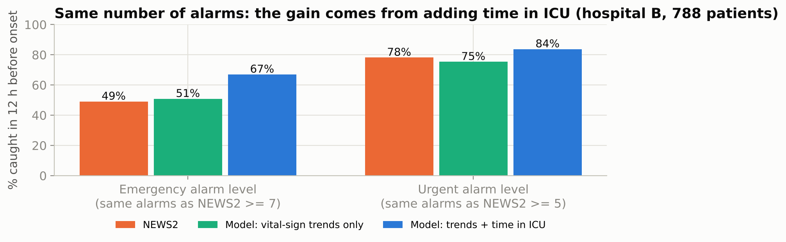
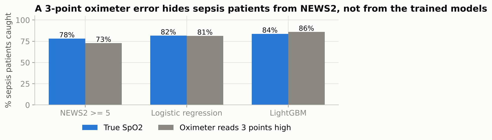
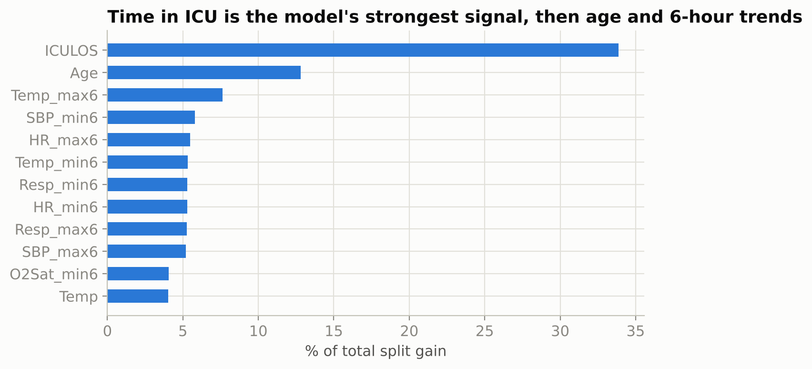
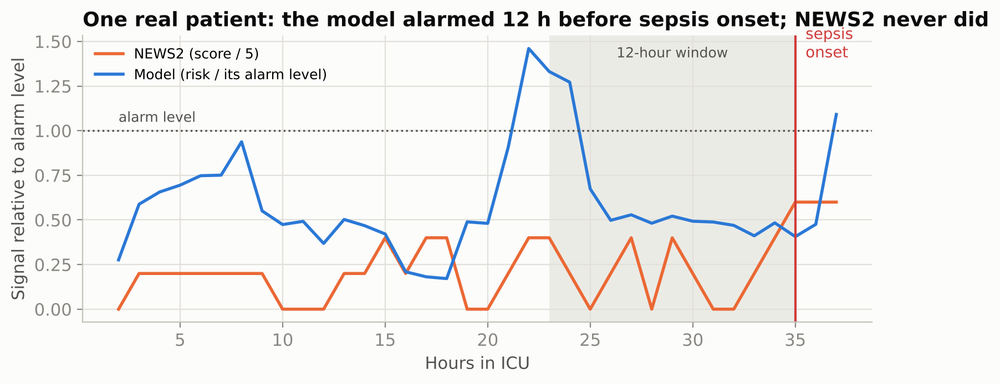

# Missed Signals

**Hospitals use a simple checklist score to spot patients who are getting sicker. We tested it on 40,000 real hospital stays. It warned early for only about half of the patients who developed sepsis. A model that also looks at trends warned for two-thirds, with the same number of alarms.**

8th Annual Datathon for Social Good, Advanced Track.

---

## The short version

1. **Sepsis** is the body's extreme reaction to an infection. It can kill within hours, so every hour of early warning matters.
2. Hospitals spot patients who are getting worse with a **checklist score**. It works like a smoke detector: when the score gets high, an alarm tells staff to check on the patient.
3. We gave the checklist and our own **computer model** the same patients and the same number of alarms. Then we counted who warned early for more sepsis patients.
4. **The checklist warned early for 49% of them. Our model warned early for 67%.** That is 141 more patients out of 788.
5. The finger clip that measures oxygen can read **too high**, and studies show this happens more often on darker skin. When we made the clip read too high, **the checklist lost about 42 more patients. Our model lost none.**

---

## Words we use

| Word | What it means |
|---|---|
| **Sepsis** | The body's extreme reaction to an infection. The immune system starts to damage the body's own organs. It is a leading cause of death in hospitals, and fast treatment saves lives. |
| **Vital signs** | The basic body measurements a nurse takes: heart rate, breathing rate, oxygen level, blood pressure, temperature, and whether the patient is alert. |
| **Pulse oximeter** | The clip on a patient's finger that measures how much oxygen is in the blood, using light. |
| **ICU** | Intensive care unit: the hospital ward for the sickest patients. |
| **NEWS2** | The checklist score that many hospitals use (National Early Warning Score 2). Each vital sign gets 0 to 3 points, and the points add up to one total. |
| **Alarm** | When the NEWS2 total reaches a set number, staff must check on the patient. **5 or more** means "urgent." **7 or more** means "emergency." |
| **Model** | A computer program that learns patterns from past patients, then uses them to judge new patients. |
| **Warned early** | An alarm went off at some point in the 12 hours before the patient developed sepsis. |
| **False alarm** | An alarm for a patient who never developed sepsis. We count them per patient per day, because each hour can raise one alarm. |

---

## The problem

### What hospitals do today

A nurse measures each patient's vital signs every few hours and adds up the NEWS2 points. For example, a fast heart rate gets points, and so does low oxygen. A high total calls a doctor.

### Why that misses people

- **It only looks at one moment.** The checklist cannot see that a heart rate has climbed for 6 hours straight. It only sees where the heart rate is now.
- **It trusts one sensor completely.** If the oxygen clip reads too high, a sick patient looks healthy, and the checklist stays quiet. A large study found that Black patients had nearly 3 times as many low-oxygen cases that the clip missed ([Sjoding et al., New England Journal of Medicine, 2020](https://pmc.ncbi.nlm.nih.gov/articles/PMC7808260)).

---

## What we did, step by step

### Step 1: We checked the datathon's dataset

The datathon gave us 1,000 patients, each with one set of vital signs and a risk label (low, medium, high).

- **We found that the labels are the NEWS2 checklist itself.** Our own NEWS2 code gave the same answer for 987 of the 1,000 patients. All 13 differences come from one small rule for patients with lung disease.
- **We found a leak.** The patient ID number alone predicts the label 99.7% of the time, so it would let a model "cheat." We removed it.

This dataset is **one snapshot per patient, with no time** and no record of who actually got sicker. So it can check our checklist code, but it cannot tell us when the checklist is wrong. We needed real outcomes over time.

### Step 2: We added real hospital data over time

We used the **PhysioNet 2019 sepsis dataset**: 40,336 real ICU stays from two US hospital systems.

- It records each patient's vital signs **every hour**, often for days.
- It marks **the hour each patient developed sepsis**.

This lets us replay each stay hour by hour and ask: "Would an alarm have gone off before sepsis started?"

### Step 3: We built a model that looks at trends

For every hour, our model sees the same vital signs as the checklist, plus:

- **how each vital sign changed over the last 6 hours** (going up or down),
- the patient's age and sex,
- **how long the patient has been in the ICU.**

### Step 4: We made the test fair

- **Different hospitals.** The model learned only from hospital A. We tested it only on hospital B, which it never saw. That shows whether it works on new patients.
- **Same number of alarms.** Any tool can catch more patients by alarming all the time. So we set our model to raise **exactly as many alarms as the checklist**. Then the only question is whether its alarms go to the right patients.

### Step 5: We tested the oxygen-clip error

We cannot see skin color in either dataset. So we **simulated** the error: we added 3 points to every oxygen reading, which is about the size of error the research reports. Then we ran the checklist and the models again.

---

## What we found



### 1. The checklist misses about half of sepsis patients

At the **emergency** alarm level (7 or more), with the same number of alarms:

| | Warned early | False alarms per patient per day |
|---|---|---|
| NEWS2 checklist | **49%** | 1.21 |
| Our model (simple version) | 61% | 1.01 |
| **Our model (best version)** | **67%** | 1.24 |

At the **urgent** alarm level (5 or more), the checklist warned early for 78% and our best model for 84%.

### 2. A wrong oxygen reading hides patients from the checklist



When the clip reads 3 points too high (urgent alarm level):

- **The checklist drops from 78% to 73%.** That is about 42 more sepsis patients with no early warning, out of 788.
- **Our models do not drop.** They judge many signals together, so one wrong number cannot fool them.

In the datathon's 1,000 patients, the same error moved **155 patients** into a lower risk group than they should be in.

### 3. The model works across groups of people

At the urgent alarm level, our model warned early for more patients than the checklist did in each of these groups:

| Group | Checklist | Our model |
|---|---|---|
| Women | 79% | 85% |
| Men | 78% | 83% |
| Under 45 | 73% | 83% |
| 80 and older | 76% | 83% |
| Surgical ICU | 83% | 88% |
| Medical ICU | **82%** | **81%** |

The model was **not** better in medical ICUs. We report that.

### 4. What drives the model



**Time in the ICU is the model's strongest clue.** A version of the model with vital signs and trends only, without time in the ICU, warned early for 51%. That is about the same as the checklist. Hospital staff do know how long a patient has been in the ICU. But in this dataset, that number may also reflect how the records were kept. So we report both versions.

### 5. One patient, replayed



For this patient from hospital B, our model's alarm went off **12 hours before sepsis**, while the checklist stayed below its alarm level.

---

## What this does not show

- **We simulated the oxygen-clip error.** Neither dataset records race, so we cannot measure the error by race directly.
- **ICU patients only.** Patients on regular wards are less sick and are measured less often. Results there may differ.
- **One illness.** We tested sepsis only.
- **Time in the ICU drives most of the gain** (see finding 4).
- **This is a research prototype, not a medical tool.** Real use would need testing on new patients as they arrive, data that includes race, and review by doctors.

---

## Why it matters

Sepsis moves fast, and every hour of warning matters. A checklist that only looks at one moment misses patients who are slowly getting worse. A sensor that reads wrong on some skin tones decides who gets help. A tool that looks at trends and many signals together can catch more patients **without adding more alarms** for already-busy staff.

---

## For technical readers

### Results in detail

| Measure | NEWS2 | Logistic regression | LightGBM | LightGBM, no ICU time |
|---|---|---|---|---|
| Hourly AUROC, hospital B | 0.701 | 0.757 | 0.784 | 0.725 |
| Caught, alarm budget = NEWS2 >= 7 | 49.1% | 60.5% | 67.0% | 50.9% |
| False alarms per patient-day (>= 7) | 1.21 | 1.01 | 1.24 | 1.14 |
| Caught, alarm budget = NEWS2 >= 5 | 78.2% | 81.6% | 83.8% | 75.4% |
| False alarms per patient-day (>= 5) | 4.18 | 3.93 | 4.80 | 3.99 |
| Caught (>= 5) with SpO2 + 3 | 72.8% | 81.3% | 85.9% | |

Health Risk dataset: NEWS2 rule accuracy 0.993; logistic regression and LightGBM 0.967. LightGBM macro-F1 is 0.63 on not-alert patients (n = 31).

### Advanced Track checklist

| Requirement | Where in `notebook.ipynb` |
|---|---|
| Trained model | Section 5: logistic regression and LightGBM, trained on hospital A only |
| Baseline | NEWS2 (published clinical rule) and majority class |
| Held-out evaluation | Section 2: 30% held-out split. Section 6: hospital B, never used for training or tuning |
| Error and fairness analysis | Sections 2a and 7: oxygen scale, oxygen use, consciousness, sex, age group, ICU type. Section 8: missed patients |
| Data decisions, checked by hand | Sections 1 and 4. `news2.py` is unit-tested against hand-scored rows |
| Reproducibility | Fixed seed 42, `requirements.txt`, raw data to results in one notebook |

### Method

1. **NEWS2** (`news2.py`): Royal College of Physicians scoring for respiratory rate, SpO2 (scales 1 and 2), oxygen use, systolic blood pressure, heart rate, consciousness and temperature.
2. **PhysioNet features**: the 5 vital signs both datasets share, carried forward within each stay; 6-hour maximum, minimum and change for each; oxygen use (FiO2 > 0.21); age; sex; hours in ICU (ICULOS). Consciousness is not recorded, so it is scored as alert.
3. **Alarm-budget matching**: each model's threshold is set on hospital A so it raises the same share of hourly alarms as NEWS2 >= 5 or >= 7. The thresholds are applied unchanged to hospital B.
4. **Early warning**: a sepsis patient counts as caught if any alarm fires in the 12 hours before onset (onset = first `SepsisLabel` hour + 6, per the challenge definition). Only stays with at least 12 hours before onset are scored (788 patients in hospital B).

### How to run

```bash
pip install -r requirements.txt
# data/Health_Risk_Dataset.csv            (datathon Drive folder)
# data/physionet/training_setA/*.psv      (PhysioNet 2019 Challenge, training_setA)
# data/physionet/training_setB/*.psv      (PhysioNet 2019 Challenge, training_setB)
jupyter nbconvert --to notebook --execute notebook.ipynb
```

Runtime: about 3 minutes on a laptop.

### Files

| File | What it is |
|---|---|
| `notebook.ipynb` | The full analysis, from raw data to results, with outputs |
| `notebook.py` | The same notebook as a plain Python script |
| `news2.py` | The NEWS2 checklist score as code |
| `plots.py` | Chart style |
| `figures/` | The 5 charts and `summary.csv` |

## Data and licenses

- Health_Risk_Dataset.csv: datathon-provided, Apache 2.0.
- PhysioNet/Computing in Cardiology Challenge 2019 (Reyna et al., Critical Care Medicine 2020), CC BY 4.0. https://doi.org/10.13026/v64v-d857
